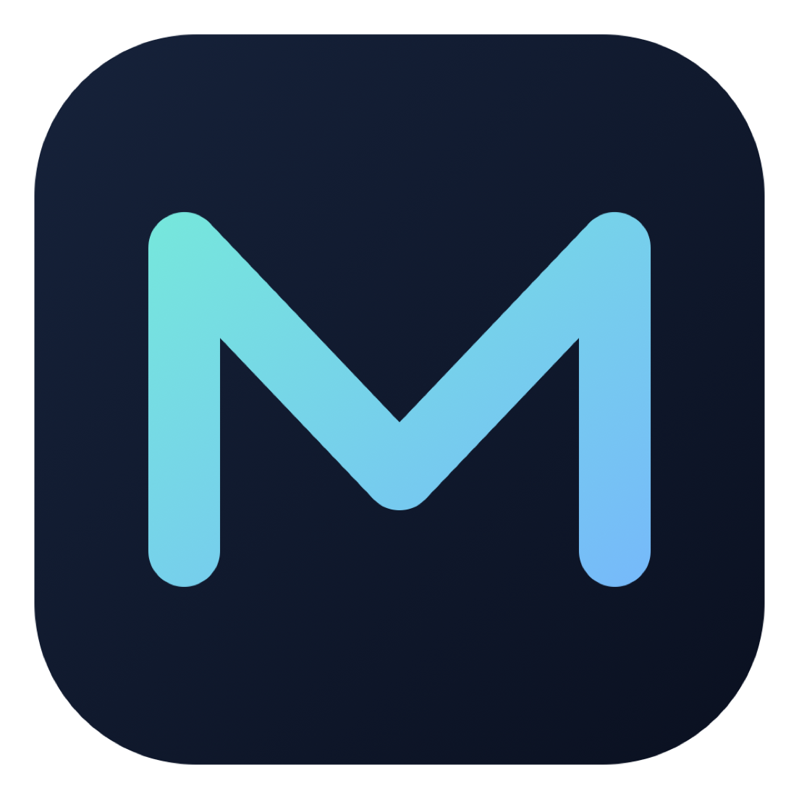
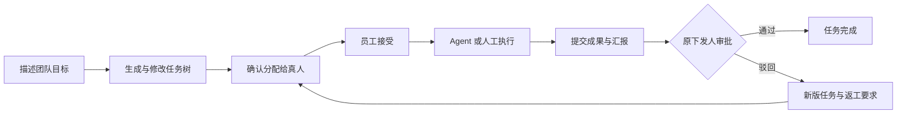

<p align="center">
  
</p>

# Merforge

**把一个目标，变成可执行、可协作、可审批的任务。**

面向个人开发者与小型团队的 AI 协作桌面应用。用 Project 组织工作，用 Bot 固定工作方式，在对话中拆解复杂目标，再把任务交给自己、Agent 或真实团队成员完成。

[新增功能](#features) · [设计思路](#design) · [快速开始](#quickstart) · [深入了解](#docs)

Merforge 基于 **DeepSeek Harness（DSH）** 的 Agent、工具、会话和 [Cordis](https://github.com/cordiverse/cordis) 插件架构开发。在这些执行能力之上，项目新增了个人 Project/Bot、持久任务计划、对话式规划、组织身份与授权、真人任务分配、成果审批，以及持续多轮的本机 Codex 对话后端。

## DSH 提供底座，Merforge 组织工作

| 能力 | DSH 提供的基础 | Merforge 在此之上的功能与设计 |
| --- | --- | --- |
| Agent 执行 | 模型调用、工具、文件与命令执行、权限机制 | 将执行关联到具体目标、任务版本、验收条件和授权范围 |
| 对话与上下文 | Session 日志、持久化、恢复和投影 | Project/Bot 归属、目标与计划关联、独立员工任务对话和审批对话 |
| 工作方法 | Skill、提示词与插件扩展点 | 内置规划方法、复杂度评估、分层任务树与顺序阶段计划、人工审核与有界推进 |
| 桌面应用 | Electron、私有 Host 与插件化 Client | 个人与组织双模式，Projects、Bots、Tasks、Recent 导航及组织工作台 |
| Codex 集成 | 单次委派执行能力 | 主对话后端、持久原生 thread、模型与推理等级选择、任务管理桥和人工请求 |
| 团队协作 | 可复用的 Agent 与会话能力 | 独立内网组织服务、真人身份、项目/任务授权、分配与接收、成果提交、审批和返工 |

<a id="features"></a>

## 新增功能

### 1. Project 管理工作上下文，Bot 管理工作方式

**Project** 聚合相关对话，并可指定新对话使用的本机目录。**Bot** 保存固定指令、默认模型和推理设置；API 后端还可按 Bot 配置工具与 Skill 允许列表。

同一条个人对话可以同时关联 Project 和 Bot，从两个入口打开都保留同一份会话记录。你可以为一个项目配置开发、审查、资料整理等不同 Bot，也可以让同一个 Bot 服务于多个项目。

归属变更有持久历史。修改 Bot 默认模型影响新对话，已有 Codex 对话保留自己的模型选择。

### 2. 在自然对话中拆解复杂目标

直接描述目标，应用按当前规划设置与权限进入相应流程：简单需求继续普通对话，信息不足时先澄清，复杂需求生成可审阅的结构化计划。

计划包含目标、范围、验收条件、产物要求、父子关系和前置依赖，支持两种组织方式：

- **分层任务树**：围绕最终目标拆分必要工作，适合明确子任务与协作分工。
- **顺序阶段计划**：按阶段安排实施与检查，适合让 Agent 在指定范围内持续推进。

后续消息可以继续澄清原目标、修改原计划或查询进度。修改产生新版本并保留历史；规划提案等待人工审核，执行范围另行确认。

### 3. 让个人长任务有明确的推进范围

任务树、依赖视图和详情使用同一份持久计划，展示版本、审核状态、前置关系及关联对话。用户明确选择任务后，可以逐步执行，也可以授权连续推进到指定阶段。

个人执行保存累计轮次、时长和动作限额，以及暂停、完成、接力和恢复状态。支持在已授权的阶段之间进行同机新对话接力，交接任务资料、已有证据和剩余授权。重启后先核对记录，未确认的操作保留为待核对状态。

API 执行路径把完成报告关联到成功工具结果和声明产物的文件哈希；Codex 路径记录其完成报告与运行结果。两种后端的证据来源分别保留，便于判断一次执行实际留下了什么。

### 4. 让真实团队在对话中分工与审批

组织模式增加账号、组织成员、直属上级、共享项目和任务权限。负责人可以在对话中审阅任务树、选择真人负责人，逐项或批量确认分配；员工通过持久收件箱接受或拒绝任务，再主动使用 Agent 或自行完成工作。



员工任务对话与下发人的对话独立。共享背景提供整体目标、决策、约束和资源；员工按授权查看任务节点，需要完整任务树时可向创建者申请。

成果可包含选定文件、文字说明、提交记录或链接。正式提交进入原下发人的审批对话；通过后任务完成，驳回则形成新版任务并重新分配。打开通知、接受任务、运行结束、正式提交和审批通过都有各自的状态与操作。

### 5. 把本机 Codex 作为持续对话后端

Merforge 使用**用户本机安装的 Codex CLI**，通过其 app-server 接入原生模型目录、推理等级、持久文字对话、流式输出、停止和重开核对。可以复用已有认证，也可在应用设置中明确发起设备码登录。

选择 Codex 后端无需配置 Merforge 的模型 API key。Bot 可保存 Codex 默认模型；任务规划、完成报告、人工提问和一次性审批接入应用已有的任务流程。

职责划分清楚：**Merforge 管理对话关联、任务、派发、权限和真人审批；Codex 管理原生上下文、工具与执行。** API 后端继续使用 DSH 的模型与工具机制。更换后端或 Codex 模型/推理等级会创建独立关联会话，源会话保留供查看。

### 6. 在同一客户端切换私人工作与内网协作

个人工作不要求创建组织。团队需要协作时，可从 Desktop 启动独立的组织 HTTPS/SQLite 服务，其他成员通过内网地址连接、核对证书并登录。

共享任务、授权、通知和成果由组织服务保存；个人对话、私人 Bot 配置和本机模型凭据留在个人空间。成员只共享明确选定的成果文件。组织与个人目录分开，组织对话的读取还需当前账号与任务权限。

组织服务随服务机 Desktop 的生命周期运行。模型和搜索按配置访问外网或企业内网服务，适合在同一局域网内进行团队协作。

<a id="design"></a>

## 设计思路

**对话是日常工作的主入口。** 个人目标、组织规划、员工执行与成果审批复用既有会话界面。任务树和工作台承担总览、修改与管理，用户可以从目标对话直接进入任务流程。

**方法指导 Agent，程序保存业务事实。** 内置 Skill 提供澄清、拆分与执行方法；任务服务负责版本、依赖、审核、分配、提交和权限。提示词中的建议要经过结构化提交和业务校验，才能成为持久任务记录。

**每次决定都对应明确的版本与身份。** 批准、分配、接受、执行和成果审批引用准确任务版本。修改计划后重新确认受影响的资格；读取、下载与写入也检查当前权限。建议负责人、真实下发人、执行员工和审批人分别记录。

**共享业务数据与私人执行记录分别保存。** 组织 SQLite 是共享业务的唯一写入者，本机 Session 保留对话与执行记录。内网接口只提供固定业务动作，个人 Host、文件和模型凭据由本机持有。

**恢复先核对持久记录。** 写操作使用操作标识和回执处理重复请求。断线或崩溃后的未知结果先查回执；恢复记录、答复人工请求和重新执行各有明确动作，避免把一次刷新当成新的执行指令。

**继续通过插件扩展 DSH。** 新能力接入 Cordis 服务、事件、工具和 Client 扩展位，复用既有 Agent 与 Session。详细实现见[架构文档](docs/architecture.md)。

<a id="quickstart"></a>

## 快速开始

当前为 **开发者预览版**，API 与持久数据格式仍会变化。首版发行目标为 macOS 和 Windows。运行前请阅读[安全说明](SAFETY.md)。

### 从源码运行

需要 Node.js **22.19.x 及以上的 22.x，或 24 及以上版本**，以及 **pnpm 11.7.0**。

```sh
git clone https://github.com/dlyqs/Merforge.git
cd Merforge
pnpm install
pnpm run dev:desktop
```

开发启动会构建并打开 Desktop，首次准备运行依赖可能需要下载。开发数据默认放在 `apps/desktop/.desktop-build/development/home`，与日常安装的数据分开。Desktop 是唯一支持的应用入口。

已构建后启动：

```sh
pnpm run build
pnpm run start:desktop
```

### 开始第一项工作

1. **选择执行后端**：在设置中配置模型 API，或先安装本机 Codex CLI，再检测认证与可用模型。参见[模型 API 配置](docs/user/guide/providers.md)与[Codex 接入说明](docs/codex-backend.md)。
2. **建立个人 Project 或 Bot**：指定项目目录、固定指令和默认模型，创建对话。
3. **描述目标并审阅计划**：确认范围、验收条件与拆分，再明确选择任务及执行方式。
4. **需要团队协作时切换组织模式**：启动或连接组织服务，建立成员与共享项目，按分配、接受、执行、提交、审批流程推进。

桌面打包、平台要求和组织服务配置见[Desktop 指南](apps/desktop/README.md)与[组织服务设计](docs/organization-foundation.md)。

## 当前实现范围

上述个人与组织模块已有代码实现和针对性工程验证。真实模型表现、Desktop 可见体验、跨机协作及各平台安装验收仍按各自验收文档单独记录；工程实现状态可查[当前概览](docs/overview.md)。

当前 Codex 主对话接入以文字为主，附件/图片、插话和分叉暂未支持。Bot 工具与 Skill 允许列表约束 API 路径；Codex 原生工具遵循其自身配置与许可。个人 Project/Bot 的自动学习记忆和跨设备同步仍为后续方向。

<a id="docs"></a>

## 深入了解

| 想了解什么 | 文档 |
| --- | --- |
| 当前代码与工程进度 | [工程概览](docs/overview.md) |
| Project、Bot 与对话归属 | [个人 Project/Bot](packages/workspace/personal-project/README.md) |
| 自动规划、目标关联与对话任务操作 | [对话规划](docs/conversation-planning.md) |
| 个人计划、阶段执行、证据与接力 | [个人工作流](docs/personal-workflow.md) |
| 组织身份、内网服务与隔离 | [组织基础](docs/organization-foundation.md) |
| 共享任务树、背景与子树授权 | [组织 WorkGraph](docs/organization-workgraph.md) |
| 分配、员工接受与持久通知 | [组织分配](docs/organization-assignment.md) |
| 成果提交、审批与返工 | [组织执行与交付](docs/organization-execution.md) |
| Codex 支持范围与恢复规则 | [Codex 后端](docs/codex-backend.md) |
| 构建、打包与桌面运行 | [Desktop 指南](apps/desktop/README.md) |
| 插件架构与参与开发 | [架构](docs/architecture.md) · [开发指南](docs/development.md) · [贡献指南](CONTRIBUTING.md) |

产品方向与后续阶段见[产品路线图](ai-native-work-os-product-roadmap.md)；路线图中的后续目标以当前实现和验收记录为准。使用 Agent 参与开发时，请遵循 [AGENTS.md](AGENTS.md)。

## 致谢与许可

Merforge 的插件化 Agent 底座源自 DeepSeek Harness，并继续使用 Cordis 的组合与生命周期机制。上游版权和许可声明保留在 [LICENSE](LICENSE)。

本仓库采用 **MIT** 许可。第三方依赖及其各自许可见 [THIRD_PARTY_NOTICES.md](THIRD_PARTY_NOTICES.md)。
